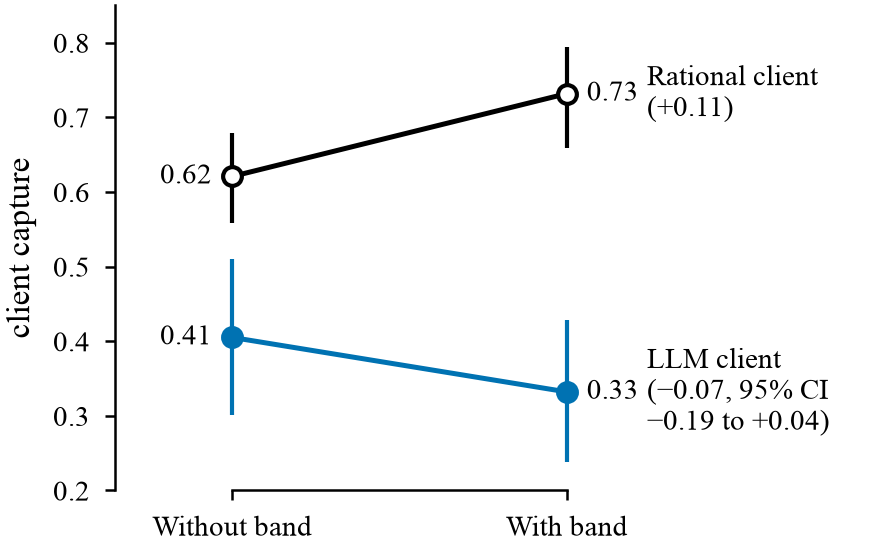

# Disclosure Without Inference: Can Disclosed Trade Data Help an LLM Trading Agent?

This project tests whether disclosing other dealers' trade data improves the outcome of an LLM agent bargaining with a dealer. In a calibrated bargaining game, the disclosure raises a rational (Bayesian) client's share of the surplus by 11 percentage points. The LLM client showed no reliable gain. It responded to the disclosure by bidding the disclosed prices directly rather than updating its estimate of the dealer's cost.

The project was completed as a solo research project for CS6101 *Rational Approaches to Cooperative Intelligence* at the National University of Singapore (MComp in Artificial Intelligence, 2026). It draws on my earlier work in FX risk management at a bank, and asks how an AI agent, rather than a human trader, performs when it must negotiate a price in a request for quote (RFQ).

**Final report and presentation:** [Report (PDF)](final_report/Main_Report.pdf) · [Slides (PDF)](final_report/Presentation_Slides.pdf) · [One negotiation, start to finish (notebook)](notebooks/one_negotiation.ipynb)

---

## Research question

LLM agents are beginning to negotiate prices on behalf of people, and the agents on either side of a trade may differ substantially in capability. A common protection for the weaker side is disclosure. When US regulators began publishing corporate bond trades through TRACE, investors' trading costs fell.

The project asks two questions:

1. Does disclosing a summary of other dealers' trades to an LLM client improve the price it obtains?
2. Does the client use that information as a Bayesian trader would, or does it anchor on the disclosed numbers?

## Experimental setup

- **Trade:** a client buys $10mm of an off-the-run 10-year US Treasury note from a single dealer by voice/chat RFQ.
- **Protocol:** the dealer quotes a price. The client either accepts it or makes a lower counteroffer. The dealer accepts the counteroffer if and only if it covers its cost; otherwise there is no trade. Quotes are firm (no last look).
- **Design choices:** off-the-run Treasuries were chosen because FINRA already publishes on-the-run trades but not off-the-run ones, making disclosure a live policy question with no FX equivalent; quotes are firm (no last look), as is standard in dealer-to-client Treasury RFQs, because with a static evaluated price last look would protect against nothing and would only give the dealer a second information advantage.
- **Private information:** the dealer knows its own cost and the client knows its own limit (the most it is willing to pay). Neither observes the other's value.
- **Disclosure ("the band"):** in the treatment conditions, the client also sees other dealers' recent purchase levels, applied to the current evaluated price, together with a stated range. This models an extension of FINRA's Treasury trade dissemination, currently limited to on-the-run issues, to off-the-run notes.
- **Calibration:** the price scale is derived from realised 10-year yield volatility (Federal Reserve GSW curve). The implied typical dealer margin is about 0.43bp, or roughly 1/32nd, within the observed range for this trade.
- **Client:** an open-weight 35B LLM (Ornith-1.5-35B) with reasoning mode off.
- **Benchmark:** a rational client that performs the Bayesian computation exactly, facing the same dealer.

## Results

| | Without the band | With the band | Change |
|---|---|---|---|
| Rational client's share of the surplus | 62% | 73% | **+11 points** |
| LLM client's share of the surplus | 41% | 33% | −7 points (95% CI −19 to +4), not significant |

In a paired comparison over the same scenarios, the LLM client gained **18 percentage points less** from the band than the rational client (95% CI 5 to 32; [paired test](notebooks/rational_gap.ipynb), exploratory).



- **The client anchors on the numbers it is shown.** Without the band, 77 of its 98 counteroffers fell exactly on one of two prices stated in its briefing. With the band, a quarter of its counteroffers fell on the lowest price of the disclosed range. The dealer's cost lies below that price only about 16% of the time, and 77% of those counteroffers were rejected.
- **The client weighs evidence in the wrong proportion.** The dealer's quote reveals little about its cost, yet the client moved its estimate substantially after seeing it (0.57g, against 0.08g for a Bayesian client). The band is far more informative, yet the client moved its estimate only half as far as a Bayesian client would.
- **The client's stated beliefs did not drive its bids.** Its elicited probabilities were coherent but did not predict where it bid. Its counteroffers also did not vary with its own limit, whereas a rational client with a higher limit bids higher.
- **The main findings held on 20 held-out scenarios** that were set aside at the start and not inspected during development.

**Relevance to electronic trading:** as LLM agents take on RFQ handling and client chat, the same weaknesses apply. How a reference price is presented to an agent, as a single level or as a range, can affect its trading as much as whether the price is shown at all. An agent should be tested against a benchmark with a known correct answer before it is trusted with pricing decisions.

---

## Research Process

**1. The rational benchmark was built before any LLM was called, and it changed the design.**
The original plan studied the reverse question: whether a dealer benefits from observing a client's past trading flow. Computing the rational dealer's gain first showed it to be approximately zero; even exact knowledge of the client's limit was worth only about 2% of the surplus. The cause is structural: the client moves last, so its counteroffer is almost always accepted and its behaviour reveals little. The same analysis showed that information disclosed to the client was worth about 11%. The study was redesigned accordingly before any LLM experiments were run.

**2. The counterparty was held fixed.**
The initial plan placed an LLM on both sides of the trade. The dealer was replaced with a fixed rational algorithm, so that the LLM client and the rational client face the same counterparty and any difference between them reflects the client alone.

**3. Pass/fail criteria were fixed before results were seen.**
The project proceeded in stages, each with a verification check defined before it ran, supported by 213 automated tests. For example, one test verifies that the client's prompt with the band is identical to the prompt without it apart from the band paragraph; another verifies that the dealer's quote is identical in every condition.

**4. The model was selected by a pre-specified rule.**
The first-choice model failed a basic competence check (67% of its counteroffers were below the quote and within its limit, against a 90% threshold). A fallback rule, written in advance, selected the replacement. Model choice did not depend on any outcome measure.

**5. A data error was identified, corrected and disclosed.**
A one-line bug in the experiment runner (a string comparison in place of a membership check) caused 90 episodes intended to run without belief elicitation to run with it. The affected data was retained separately rather than deleted, the code was fixed and tested, the episodes were rerun, and the incident is recorded in the [experiment log](notebooks/experiment_log.ipynb).

**6. The main hypothesis was pre-registered, and the null result is reported.**
The primary hypothesis and its analysis code were committed to git before any data with the band was collected ([prereg.md](prereg.md)). The hypothesis was not supported, and the report states this directly. The analysis was then repeated on held-out scenarios.

**7. Every run is documented.**
The [experiment log](notebooks/experiment_log.ipynb) records what was run, when, on which git commit, and with what result, including errors. Each entry is followed by a code cell that reruns the corresponding analysis, so the reported figures can be checked against the script output.

---

## Repository contents

| File | Description |
|---|---|
| `generator.py` | Generates each scenario: evaluated price, dealer cost, client limit and the band |
| `env.py` | The game: moves, payoffs and rule violations |
| `rational.py` | The rational client and dealer (optimal counteroffer, acceptance threshold, dealer's optimal quote) |
| `benchmarks.py` | The Bayesian update of the client's belief about the dealer's cost, given the band |
| `render.py` | Builds the client's prompt, identical across conditions except for the band paragraph |
| `agents.py` | Calls the LLM, parses its JSON replies and retries malformed ones |
| `run.py` | Runs the experiment, logging one line per negotiation; resumable after interruption |
| `disclosure_results.py`, `analysis.py` | The pre-registered analysis (bootstrap confidence intervals over scenarios) |
| `tests/` | 213 tests, one file per stage |
| `logs/` | Every negotiation the LLM played: prompts, raw replies, outcome and git commit (one JSON line each) |
| `final_report/` | The report and slides (PDF), and a note on how the setup maps to eFX execution |
| `report_generation/` | The report and slides in LaTeX, and `figures.ipynb`, which rebuilds every figure |

**Notebooks** (in `notebooks/`, saved with outputs so they can be read without running):

| Notebook | Contents |
|---|---|
| [`one_negotiation.ipynb`](notebooks/one_negotiation.ipynb) | One trade through every condition, alongside the rational client |
| [`rational_benchmark.ipynb`](notebooks/rational_benchmark.ipynb) | The value of the band to a rational client, how little the quote reveals, and the analysis behind the redesign |
| [`calibration.ipynb`](notebooks/calibration.ipynb) | Derivation of the price scale from Federal Reserve yield-curve data, cross-checked against two other sources |
| [`experiment_log.ipynb`](notebooks/experiment_log.ipynb) | Dated record of every run and decision, with each analysis rerun below its entry |
| [`rational_gap.ipynb`](notebooks/rational_gap.ipynb) | Paired test of the LLM's shortfall against the rational client (exploratory, added after the results) |

### Reproducing the results

```bash
conda env create -f environment.yml
conda activate cosi
pytest                # 213 tests, about 10 seconds
```

Everything except the LLM calls can be reproduced from a fresh clone: the tests, notebooks, analysis and report figures all read the committed logs. The LLM calls used the National University of Singapore's internal model API, which is accessible only on the university network. The calibration notebook also requires internet access to download the yield-curve data.

## Limitations

The game is deliberately simplified to isolate the effect of information. There is a single dealer, so the client has no competing quotes; the client makes one counteroffer rather than negotiating back and forth; and walking away is worth nothing. Costs and limits are synthetic, and only the price scale is calibrated to market data. A single model was tested, with reasoning mode off. The findings therefore describe this model in this game, not LLM agents in general or real markets.

---

*Joey Poh · National University of Singapore · 2026*
